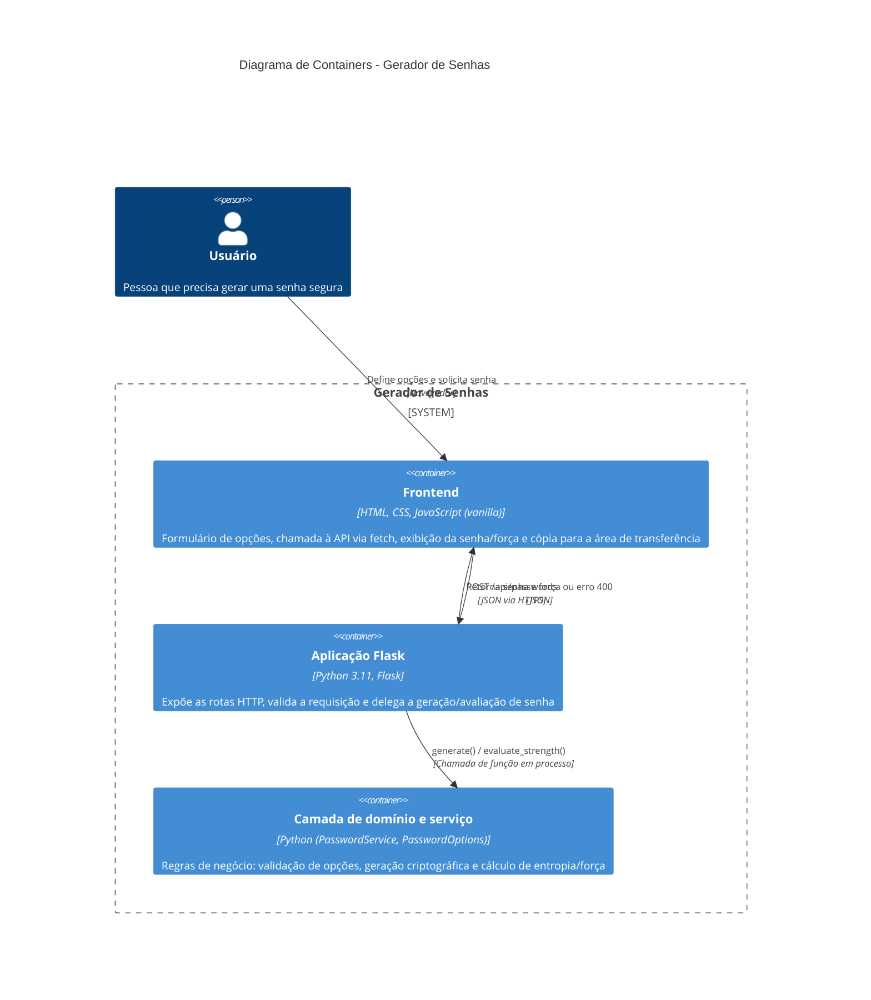
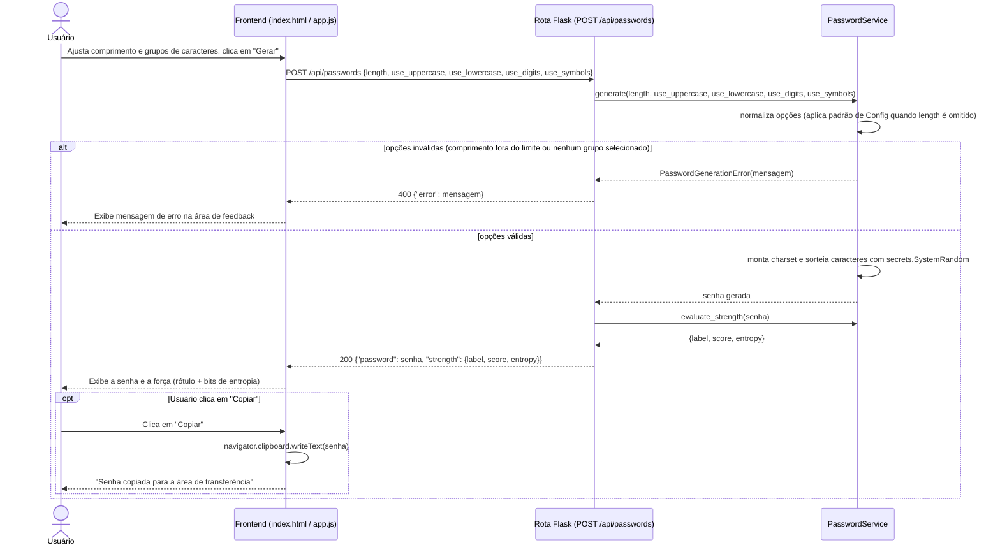

# Documentação de Discovery (Diagrams as Code) - Gerador de Senhas

## Contexto

Este módulo aplica os conceitos de **diagrams as code** estudados na Unidade III ao mesmo projeto prático desenvolvido nos módulos anteriores (`01-projeto-pratico`). A proposta foi conduzir uma pequena fase de discovery de documentação: descrever o sistema em linguagem natural, usar Inteligência Artificial Generativa para gerar diagramas estruturais e comportamentais em Mermaid, e registrar as decisões e ajustes feitos sobre o que o modelo produziu.

## Cenário utilizado

**Projeto real acadêmico**: aplicação web de geração de senhas seguras em Python/Flask.

- Repositório: `01-projeto-pratico/`
- Tecnologias: Python 3.11, Flask, JavaScript vanilla
- Documento de entrada: descrição do sistema escrita manualmente antes da geração dos diagramas (ver `docs/descricao-do-sistema.md`), para permitir comparar o que foi pedido com o que a IA de fato produziu

## Estrutura dos artefatos

```text
04-documentacao-discovery/
|-- README.md                                    (este arquivo)
`-- docs/
    |-- descricao-do-sistema.md                  (escopo, nivel de visao, limites, integracoes, restricoes, lacunas)
    `-- diagramas/
        |-- containers.mmd                       (diagrama estrutural, fonte Mermaid versionada)
        `-- sequencia-geracao-senha.mmd           (diagrama comportamental, fonte Mermaid versionada)
```

Os arquivos `.mmd` são a versão "as code" dos diagramas: podem ser abertos em qualquer editor com suporte a Mermaid, revisados em pull request como texto e regenerados a qualquer momento. Os mesmos diagramas estão embutidos abaixo para renderização direta no README.

## Metodologia

1. **Descrição textual do sistema**, escrita antes de pedir qualquer diagrama à IA, cobrindo escopo, nível de visão, limites/responsabilidades, integrações, restrições e lacunas (`docs/descricao-do-sistema.md`).
2. **Geração assistida por IA Generativa** de um diagrama estrutural (containers, inspirado em C4) e um comportamental (sequência da jornada crítica: gerar uma senha), a partir da leitura do código-fonte de `01-projeto-pratico`.
3. **Confronto de cada diagrama com o código real** (`routes.py`, `password_service.py`, `domain/models.py`, `static/js/app.js`), para identificar o que foi inferido corretamente e o que precisou de correção.
4. **Registro das decisões e ajustes** feitos sobre a proposta inicial da IA.

## Descrição do sistema (resumo)

Aplicação de página única para gerar senhas aleatórias e criptograficamente seguras, sem cadastro de usuários, sem autenticação e **sem qualquer persistência** — a ausência de banco de dados é uma decisão de negócio (nunca guardar a senha gerada), não uma limitação técnica. O nível de visão escolhido foi C4 Contexto + Containers; um diagrama de Componentes foi avaliado e descartado por desproporcional ao tamanho do backend (um único processo Flask pequeno). Descrição completa, incluindo tabela de limites/responsabilidades e lacunas conhecidas, em [`docs/descricao-do-sistema.md`](docs/descricao-do-sistema.md).

## Diagrama estrutural - Containers (C4)



Fonte versionada: [`docs/diagramas/containers.mmd`](docs/diagramas/containers.mmd)

## Diagrama comportamental - Sequência: gerar uma senha



Fonte versionada: [`docs/diagramas/sequencia-geracao-senha.mmd`](docs/diagramas/sequencia-geracao-senha.mmd)

## O que a IA inferiu corretamente

- A separação em três containers (frontend, aplicação Flask, camada de domínio/serviço), coerente com a organização real de pastas do projeto.
- O endpoint único relevante para a jornada crítica (`POST /api/passwords`) e o payload de entrada/saída, a partir da leitura de `routes.py`.
- O caminho de erro (400 com `PasswordGenerationError`) como um ramo explícito do diagrama de sequência, não apenas o caminho feliz.
- Que a geração de senha é síncrona e local ao processo (sem chamada de rede adicional entre a rota e o serviço).

## O que precisei ajustar

| Proposta inicial da IA | Ajuste feito | Motivo |
|---|---|---|
| Incluir um container de banco de dados ("Password History Store") para guardar senhas geradas | **Removido** | O próprio requisito de negócio (levantado em `03-elicitacao-de-requisitos`) proíbe armazenar a senha em qualquer lugar; a IA assumiu persistência por ser o padrão comum em aplicações CRUD, sem essa informação de contexto. |
| Representar a cópia para a área de transferência como uma chamada adicional ao backend (`POST /api/clipboard`) | **Corrigido** | A cópia é 100% client-side via `navigator.clipboard.writeText`, sem envolver o servidor; a IA inferiu um endpoint que não existe no código. |
| Diagrama de Componentes (nível 3) detalhando `routes.py`, `domain/models.py`, `services/password_service.py` e `config.py` separadamente | **Descartado por ora** | Nível de detalhe desproporcional a um backend de um único endpoint; mantido apenas o nível de Containers, com a divisão component-level registrada como extensão futura em `docs/descricao-do-sistema.md`. |
| Adicionar um container genérico de "Autenticação/Gateway" entre o frontend e a aplicação | **Removido** | O sistema não possui autenticação nem gateway; é um único processo Flask servindo tudo. A IA propôs esse container por ser um padrão comum em diagramas C4 de exemplo, não porque houvesse evidência no código. |
| Nomear o container de regra de negócio genericamente como "Backend Logic" | **Renomeado** para "Camada de domínio e serviço" | Alinhar o nome do container aos nomes reais das classes (`PasswordService`, `PasswordOptions`), facilitando a rastreabilidade entre diagrama e código. |

## O que a documentação ainda precisaria ter para um agente construir o sistema sem inventar decisões

- **Diagrama de implantação (deployment)**: hoje não há decisão registrada sobre servidor WSGI, contêiner ou provedor de nuvem — um agente teria que inventar essa parte.
- **Contratos de API formais** (ex.: OpenAPI/JSON Schema) para `POST /api/passwords`, incluindo os valores exatos aceitos e as mensagens de erro, hoje descritos apenas em prosa e no código.
- **Regras de negócio numeradas e testáveis** (RF/RN/RNF), já existentes em `03-elicitacao-de-requisitos/docs/analise-requisitos-e-regras-de-negocio.md` — este módulo não as referencia diretamente nos diagramas, e um agente de desenvolvimento precisaria receber os dois artefatos juntos.
- **Decisões de não escopo explícitas** (sem autenticação, sem rate limiting, sem histórico) como restrições formais, e não apenas como "lacunas conhecidas" em prosa — hoje um agente poderia "corrigir" essas ausências por conta própria, achando que são omissões.
- **Versionamento do próprio diagrama** vinculado a uma versão do código (ex.: tag de commit), para o agente saber se a documentação ainda reflete o estado atual do repositório.

## Limitações e cuidados percebidos no uso da IA

1. **Viés para padrões genéricos de arquitetura web**: sem o contexto de que a persistência é proibida por requisito de negócio, a IA por padrão assume que toda aplicação com "senha" e "usuário" precisa de banco de dados e autenticação.
2. **Necessidade de validação linha a linha contra o código**: assim como observado em `03-elicitacao-de-requisitos`, diagramas gerados a partir de descrição textual (sem ler o código-fonte) tendem a inventar endpoints e containers plausíveis, mas inexistentes.
3. **Ambiguidade do nível de detalhe correto**: a IA tende a sugerir o nível de detalhe mais completo possível (ex.: diagrama de componentes) por padrão; coube a mim, com base no tamanho real do projeto, decidir parar no nível de Containers.

## Link do repositório

https://github.com/murillostein/especializacao-akcit
