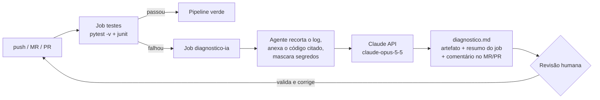

# DevOps com IA Generativa - Diagnóstico de Falhas no Pipeline

## Contexto

Este módulo aplica a Unidade 5 (Projeto Integrador de DevOps com IA Generativa) ao mesmo tema dos módulos anteriores, o Gerador de Senhas. A proposta do laboratório é ter uma aplicação Python com um **erro intencional**, testes automatizados, um pipeline de CI/CD e um **agente de IA generativa** que lê o log da falha e sugere a correção.

A aplicação é um **estimador de tempo de quebra de senha**: recebe a entropia calculada pelo `PasswordService.evaluate_strength` do módulo `01-projeto-pratico` e diz quanto tempo, em média, um atacante levaria para achar a senha por força bruta, e se isso atende a política de segurança.

## Fluxo do pipeline



O job de diagnóstico **nunca altera código nem muda o status do pipeline**. Quem reprova a entrega é o job de testes. A IA só produz uma sugestão, que um humano valida.

## Estrutura

```text
06-devops-genai/
|-- README.md                       (este arquivo: análise e texto do fórum)
|-- .gitlab-ci.yml                  (pipeline GitLab CI)
|-- requirements.txt                (pytest)
|-- requirements-agente.txt         (anthropic, só no job de diagnóstico)
|-- pytest.ini
|-- app/
|   |-- config.py                   (política lida do ambiente; contém o erro intencional)
|   |-- tempo_quebra.py             (estimativa, formatação, avaliação)
|   `-- __main__.py                 (python -m app <bits>)
|-- agente/
|   `-- diagnosticar_falha.py       (agente de diagnóstico com GenAI)
|-- tests/
|   |-- test_tempo_quebra.py        (16 testes da aplicação)
|   `-- test_agente.py              (8 testes das partes determinísticas do agente)
`-- docs/
    |-- evidencias/                 (logs do pytest, prompts enviados, relatório sem credencial)
    |-- saida-ia/                   (respostas brutas da LLM, sem edição)
    `-- correcao/
        `-- correcao-validada.patch (correção depois da validação humana)

.github/workflows/devops-genai.yml  (pipeline GitHub Actions, na raiz do repositório por exigência do GitHub)
```

## O erro intencional

Em `app/config.py`, a taxa de tentativas do atacante é lida do ambiente **sem conversão de tipo**:

```python
"tentativas_por_segundo": os.getenv("TENTATIVAS_POR_SEGUNDO", "1e10"),   # str, não float
"tempo_minimo_anos": float(os.getenv("TEMPO_MINIMO_ANOS", "100")),       # este está certo
```

`os.getenv` sempre devolve `str`. O erro **nasce** na configuração, mas só **estoura** longe dali, em `app/tempo_quebra.py:31`, quando um `float` é dividido pela string `'1e10'`. Escolhi esse cenário de propósito: o traceback aponta para o lugar errado, e `config.py` nem aparece nele. Isso testa se a IA encontra a causa raiz ou só remenda o sintoma.

Resultado no pipeline: **5 testes falham** (2 `AssertionError` no contrato da configuração e 3 `TypeError` na estimativa). Os testes que passam a taxa explicitamente continuam passando. Log completo em [`docs/evidencias/pytest-falha.log`](docs/evidencias/pytest-falha.log).

## Como executar

**Localmente**

```bash
cd 06-devops-genai
pip install -r requirements.txt -r requirements-agente.txt
python -m pytest -v 2>&1 | tee pytest.log                     # falha: 5 failed
python agente/diagnosticar_falha.py --log pytest.log          # gera diagnostico.md e prompt-enviado.md
```

Sem `ANTHROPIC_API_KEY`, o agente não quebra: salva o prompt completo e um relatório dizendo que a análise não foi executada ([exemplo](docs/evidencias/diagnostico-sem-credencial.md)). A opção `--somente-prompt` faz o mesmo de propósito.

**GitHub Actions**: o workflow `.github/workflows/devops-genai.yml` roda em push e PR que toquem `06-devops-genai/`. Crie o secret `ANTHROPIC_API_KEY` no repositório. Em PR, o diagnóstico vira comentário; em qualquer execução, aparece no resumo do job e como artefato `diagnostico-ia`.

**GitLab CI**: em *Settings > CI/CD > General pipelines*, aponte o arquivo de configuração para `06-devops-genai/.gitlab-ci.yml`. Crie as variáveis mascaradas `ANTHROPIC_API_KEY` e, para comentar no Merge Request, `GITLAB_API_TOKEN` (escopo `api`). O job `diagnostico_ia` usa `when: on_failure` e `allow_failure: true`.

**Aplicar a correção validada** (a partir da raiz do repositório):

```bash
git apply 06-devops-genai/docs/correcao/correcao-validada.patch
```

## O agente de diagnóstico

[`agente/diagnosticar_falha.py`](agente/diagnosticar_falha.py) faz uma única chamada à API do Claude (`claude-opus-5-5`). Antes disso, prepara o contexto:

| Etapa | Por quê |
|---|---|
| Recorta o log a partir de `FAILURES` (limite de 40 mil caracteres, com aviso explícito se cortar) | O cabeçalho do pytest não ajuda e só gasta tokens |
| Anexa, numerado, o **código-fonte citado no traceback** | Lição do módulo 05: contexto literal evita que a LLM invente código |
| Anexa também os **módulos do projeto importados** por esses arquivos | O traceback mostra onde o erro estoura, não onde nasce (ver experimento abaixo) |
| Mascara segredos (`sk-ant-`, `glpat-`, `ghp_`, `AKIA...`, `token=...`) | O log vai para um serviço externo |
| Troca caminhos absolutos da máquina por `<projeto>` e `<home>` | Na primeira execução local, o log continha o caminho com o meu nome de usuário |
| System prompt com regras: não inventar, separar fato de hipótese, buscar causa raiz, **não relaxar testes** | Evita a "correção" que só silencia o teste |
| Formato fixo: resumo, evidências, causa raiz, diff, como validar, confiança e premissas, prevenção | Torna a resposta revisável e comparável entre execuções |
| Salva o prompt enviado (`prompt-enviado.md`) como artefato | Auditoria: dá para ver exatamente o que a IA recebeu |
| Trata erros da API (credencial, 429, 5xx, rede, recusa) e sempre sai com código 0 | Uma falha na IA não pode esconder nem substituir a falha dos testes |
| Usa `fallbacks: "default"` (beta `server-side-fallback-2026-07-01`) | Se o modelo recusar o pedido, a própria API refaz a chamada num modelo alternativo |

## Experimento: quanto contexto a IA precisa?

Rodei o mesmo log com dois prompts gerados pelo agente:

- **A**: só os arquivos do traceback (`--sem-imports`): `tests/test_tempo_quebra.py` e `app/tempo_quebra.py`.
- **B**: o padrão do agente, que inclui também `app/config.py`, importado por `tempo_quebra.py`.

Como não havia chave de API na máquina local, cada prompt foi executado no **mesmo modelo que o agente usa (Claude Opus 5.5)**, em sessão isolada via Claude Code: sem histórico, sem acesso ao repositório, só com o texto do prompt. Os prompts estão em [`docs/evidencias/`](docs/evidencias/) e as respostas brutas em [`docs/saida-ia/`](docs/saida-ia/). No pipeline, o mesmo prompt vai direto para a API.

| | A: só traceback | B: com imports |
|---|---|---|
| Achou que a causa está em `config.py`? | **Sim**, por dedução: o assert `isinstance('1e10', float)` entrega | **Sim**, apontando `config.py:14` |
| Diff aplicável? | **Não**: esboço com linhas supostas (`tentativas = ...`), avisado como esboço | **Sim**: uma linha, aplica direto |
| Rejeitou a correção só no sintoma (`float()` em `tempo_quebra.py`)? | Sim, explicando que os testes de contrato continuariam falhando | Sim |
| Defendeu não relaxar os testes? | Sim | Sim |
| Afirmações erradas | **1 hipótese falsa**: que `tempo_minimo_anos` teria o mesmo defeito (a linha 15 já converte). Estava marcada como hipótese | Nenhuma encontrada. A conta "11 que passaram = 4 com taxa explícita + 7 parametrizados" confere |
| Confiança declarada | Alta no diagnóstico, média na correção | Alta |

**Leitura:** com pouco contexto, a IA acertou a direção, mas preencheu as lacunas com suposições: inventou as linhas do diff e "estendeu" o defeito para um campo sadio. Com o arquivo certo no prompt, a resposta virou um patch exato. A qualidade do diagnóstico dependeu mais do **contexto que o agente monta** do que do modelo.

## Validação humana da correção sugerida

Apliquei a correção da IA (prompt B) numa cópia do módulo: **24/24 testes passaram**, e o pipeline ficaria verde. Mesmo assim, testei à mão os valores que a variável de ambiente pode receber:

| `TENTATIVAS_POR_SEGUNDO` | Com a correção da IA | Problema |
|---|---|---|
| `abc` | `ValueError: could not convert string to float` | Aceitável, mas a mensagem não diz qual variável |
| `0` | `ZeroDivisionError` | Erro tardio, no meio do cálculo |
| `-5` | "instantâneo" | **Silencioso**: resultado sem sentido, sem erro |
| `inf` | "instantâneo" | **Silencioso** |
| `nan` | "mais de mil anos" e "**NÃO** atende a política" | **Contraditório**: a interface diria as duas coisas ao mesmo tempo |

Nenhum teste cobria esses casos, então "pipeline verde" não significava "correção completa". O prompt A chegou a sugerir validar `> 0`. O B, mais preciso no patch, não sugeriu.

A [correção validada](docs/correcao/correcao-validada.patch) mantém a ideia da IA (converter na fronteira, em `config.py`), mas:

1. centraliza a leitura num helper `_ler_float_positivo(nome, padrao)`, que é a medida de prevenção nº 1 sugerida pelas duas respostas;
2. rejeita valores não numéricos, zero, negativos, `inf` e `nan` com `ValueError` que **cita a variável**;
3. aplica a mesma regra a `TEMPO_MINIMO_ANOS`;
4. adiciona 12 casos de teste (`test_politica_rejeita_valores_invalidos`) com os valores acima.

Resultado: **36 passed** ([log](docs/evidencias/pytest-apos-correcao.log)).

> Observação: o experimento A/B rodou quando a suíte tinha só os 16 testes da aplicação (`5 failed, 11 passed`). Os 8 testes do agente vieram depois. Por isso, no pipeline, a falha aparece como `5 failed, 19 passed`.

## Desafios encontrados

1. **A causa raiz não aparece no log.** `config.py` não está em nenhuma linha do traceback. A primeira versão do agente só anexava os arquivos citados, e foi isso que motivou a inclusão dos módulos importados.
2. **Vazamento de dados no log.** O log local tinha o caminho absoluto com o meu nome de usuário. Num runner é `/builds/...`, mas o agente também roda localmente. Adicionei anonimização de caminhos e máscara de segredos antes do envio.
3. **O próprio código "entregava" a resposta.** A primeira versão de `config.py` tinha um comentário "ERRO INTENCIONAL". Com ele no prompt, o teste da IA perderia o sentido. Removi o comentário (o erro fica documentado só aqui).
4. **Falha sem credencial.** Sem `ANTHROPIC_API_KEY`, o SDK não falha ao criar o cliente, só na hora da requisição, com um `TypeError` genérico. Na primeira execução local, o job de diagnóstico quebrou. Passei a checar a credencial antes e a gerar um relatório explicando o motivo.
5. **`tee` esconde a falha.** `pytest | tee pytest.log` devolve o código de saída do `tee` (0), e o pipeline ficaria verde com testes falhando. Os dois pipelines usam `set -o pipefail`.
6. **Pipeline por módulo num repositório com vários módulos.** O GitHub exige o workflow na raiz (`.github/workflows/`), então usei filtro `paths`. No GitLab, mantive o `.gitlab-ci.yml` dentro do módulo e documentei o caminho customizado.
7. **Versão do SDK.** A versão mais nova do pacote `anthropic` tinha saído havia três dias. Fixei a `2.3.0` (com três semanas) depois de confirmar que ela já suportava os parâmetros usados.
8. **Sem chave de API local.** A análise registrada foi feita com o mesmo modelo, em sessão isolada, com exatamente o prompt que o agente gera. A chamada real à API foi verificada até a autenticação (uma chave inválida devolveu `AuthenticationError`, tratado sem derrubar o job).

## Reflexão crítica

**Vantagens observadas**

- **Velocidade de triagem.** Em segundos, a IA cruzou 5 falhas de 2 tipos diferentes e concluiu que tinham uma causa só.
- **Raciocínio sobre causa x sintoma.** As duas respostas recusaram o `float()` no lugar do erro e explicaram por quê, citando os testes de contrato.
- **Formato revisável.** Separar evidência, hipótese e confiança deixou fácil conferir cada afirmação.
- **Prevenção útil.** As medidas sugeridas (helper de leitura, `mypy`/`TypedDict`, testes de contrato) são concretas e foram aproveitadas.

**Limitações observadas**

- **Sem contexto, a IA completa o que falta.** O prompt A produziu um diff com linhas inventadas e uma hipótese falsa. As duas vinham sinalizadas, mas um leitor apressado poderia aplicá-las.
- **"Verde" não é "correto".** A correção mais precisa passou em todos os testes e ainda deixava `0`, `-5`, `inf` e `nan` produzirem resultados errados ou contraditórios. A IA otimiza para o que o log mostra, e o log só mostra o que os testes cobrem.
- **Custo e dependência externa.** Cada falha gera uma chamada paga a um serviço externo, que pode falhar, sofrer rate limit ou estar sem crédito. Por isso o agente não pode ser bloqueante.
- **Superfície de vazamento.** Log e código saem do ambiente. Mascarar segredos é obrigatório, e mesmo assim depende de padrões conhecidos.

**Por que validar antes de aplicar.** O diagnóstico da IA é uma hipótese bem escrita, não uma prova. Neste laboratório, validar significou: (1) conferir no código cada afirmação (uma era falsa); (2) aplicar o patch numa cópia e rodar a suíte; (3) testar entradas que a suíte não cobria, o que revelou três comportamentos errados; (4) transformar esses casos em testes, para que a próxima regressão apareça no pipeline e não em produção. A IA acelerou a investigação. A responsabilidade pela correção continuou humana.

## Link do repositório

https://github.com/murillostein/especializacao-akcit/tree/main/06-devops-genai

---

## Texto para o fórum

> **Repositório:** https://github.com/murillostein/especializacao-akcit/tree/main/06-devops-genai
> O pipeline está em `.github/workflows/devops-genai.yml` (GitHub Actions) e em `06-devops-genai/.gitlab-ci.yml` (GitLab CI, com as mesmas etapas).
>
> **Execução do projeto.** Mantive o tema do Gerador de Senhas: a aplicação estima o tempo médio para quebrar uma senha por força bruta a partir da entropia. O pipeline tem dois jobs:
> 1. **testes**: instala as dependências e roda o `pytest -v` com relatório JUnit e log salvo como artefato (`set -o pipefail`, para o `tee` não esconder a falha);
> 2. **diagnostico-ia**: só roda se o primeiro falhar. O agente lê o log, anexa o código citado e envia tudo ao Claude, que devolve um `diagnostico.md`, publicado no resumo do job e como comentário no PR/MR.
>
> O erro intencional está em `config.py`: `os.getenv("TENTATIVAS_POR_SEGUNDO", "1e10")` sem conversão para `float`. Resultado: **5 testes falham**, sendo 2 `AssertionError` no contrato da configuração e 3 `TypeError: unsupported operand type(s) for /: 'float' and 'str'` em `tempo_quebra.py:31`.
>
> **Análise com IA generativa.** Escolhi o erro de propósito: ele **estoura** em `tempo_quebra.py`, mas **nasce** em `config.py`, que nem aparece no traceback. Rodei o mesmo log com dois prompts:
> - **só com os arquivos do traceback**: a IA deduziu a causa certa, mas o diff foi um esboço com linhas inventadas, e ela levantou uma hipótese falsa (que outro campo tinha o mesmo defeito);
> - **com os módulos importados** (padrão do agente): apontou `config.py:14` e deu um patch de uma linha.
>
> Nas duas, a IA **recusou a correção só no sintoma** (`float()` na linha da divisão) e defendeu não relaxar os testes.
>
> **Validação humana.** Apliquei o patch da IA: 24/24 testes verdes. Mas, testando valores da variável à mão: `0` dava `ZeroDivisionError`, `-5` e `inf` diziam "instantâneo", e `nan` dizia "mais de mil anos" e "não atende a política" ao mesmo tempo. A correção final centraliza a leitura num helper que rejeita esses valores, com 12 novos testes (36 passed).
>
> **Desafios:** a causa raiz não aparece no log (o agente passou a anexar os imports); o log local continha o meu caminho de usuário (adicionei anonimização e máscara de segredos); sem chave de API, o SDK só falha na requisição (o agente passou a checar antes e nunca derruba o pipeline); o GitHub exige o workflow na raiz do repositório (filtro `paths` por módulo).
>
> **Reflexão:** a IA foi ótima em triagem e em separar causa de sintoma, mas a qualidade dependeu do contexto que o agente montou, e "pipeline verde" não significou "correção completa". O diagnóstico é uma hipótese bem escrita. É preciso conferir cada afirmação no código, rodar o patch numa cópia e testar o que a suíte não cobre, antes de aplicar.
